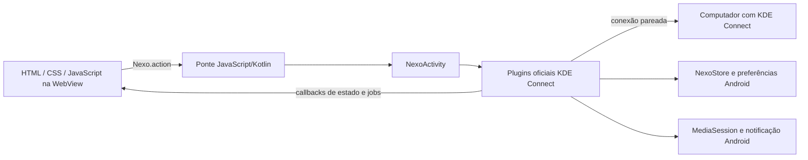

# Nexo

Aplicativo Android em português para controlar um computador pelo celular usando a infraestrutura oficial do KDE Connect. O Nexo acrescenta uma interface própria em HTML, CSS e JavaScript dentro de uma WebView; o pareamento, o transporte entre dispositivos e as operações remotas continuam usando o KDE Connect.

**Estado atual:** desenvolvimento v0.3. O código compila como variante Android `debug`. A compilação e os testes automatizados não substituem a validação no telefone e no computador reais.

## Funcionalidades

O aplicativo mantém seis telas:

| Tela | O que existe no código | Estado e dependências |
|---|---|---|
| **Início** | Dispositivo principal, conexão, atalhos configuráveis e acesso às rotinas. | Implementado. |
| **Dispositivos** | Descoberta, seleção, pareamento, desconexão e remoção pelo KDE Connect. | Implementado; o pareamento ainda exige confirmação nos dispositivos. |
| **Arquivos** | Envio e recebimento oficial, histórico de transferências, detalhes, abertura de arquivos recebidos e nova tentativa quando a URI ainda pode ser lida. | Implementado no código; depende do plugin Compartilhar e das permissões do Android. O estado de sucesso significa sucesso reportado pelo KDE Connect, não confirmação adicional de leitura no destino. |
| **Controle** | Touchpad, teclado remoto, central MPRIS, volume global pelo plugin System Volume, brilho e iluminação por comandos remotos, apresentação e sessão/energia. | Os controles disponíveis no código dependem dos plugins, capacidades anunciadas e comandos configurados no computador. Não há validação ponta a ponta declarada para o hardware de destino. |
| **Automações** | Rotinas manuais e ação de pausar mídia ao conectar. | Parcial/experimental: a observação de conexão ocorre enquanto o Nexo está aberto; outras automações exibidas como indisponíveis não estão implementadas. |
| **Configurações** | Permissões Android, notificações, aparência, preferências de sincronização, informações e licenças. | Implementado; algumas preferências abrem a interface oficial do KDE Connect. |

### Recursos que dependem de configuração

- Touchpad, teclado, MPRIS e volume precisam estar disponíveis no KDE Connect dos dois dispositivos.
- Os controles de brilho, teclado e energia só ficam operacionais quando seus comandos estão cadastrados no plugin oficial de comandos remotos e anunciados pelo computador.
- O volume da central é o volume global anunciado pelo plugin System Volume. O volume MPRIS de um reprodutor é uma capacidade distinta.
- Espelhamento de tela, projetos sincronizados, gatilhos de captura e pausa automática durante chamadas aparecem como indisponíveis ou não implementados; não fazem parte das capacidades concluídas do Nexo.

## Arquitetura

O Nexo combina a aplicação Android/Kotlin herdada do KDE Connect com uma interface web local empacotada no APK. A ponte JavaScript/Kotlin encaminha ações para os plugins oficiais; os eventos dos plugins atualizam a interface. Não há protocolo de rede alternativo do Nexo.



Detalhes da ponte, do estado e do ciclo de vida estão em [docs/ARCHITECTURE.md](docs/ARCHITECTURE.md). Ambiente de desenvolvimento e comandos de build estão em [docs/DEVELOPMENT.md](docs/DEVELOPMENT.md). A configuração dos comandos remotos está em [docs/COMMANDS.md](docs/COMMANDS.md).

## Requisitos

- Android SDK Platform 37 e ferramentas de build correspondentes, conforme `compileSdk`/`targetSdk` em `build.gradle.kts`.
- JDK 17 ou mais recente compatível com o Android Gradle Plugin do projeto. A compilação usa o Gradle Wrapper 9.6.0, Android Gradle Plugin 9.5.1 e Kotlin 2.4.21 conforme os arquivos versionados.
- Android 6.0/API 23 ou superior para instalação, conforme `minSdk`.
- Node.js apenas para verificar a sintaxe de JavaScript; não é necessário para o APK.
- No computador, o KDE Connect para desktop, pareamento ativo e os plugins necessários para os controles escolhidos. `brightnessctl` é necessário somente para comandos de brilho que o utilizem.

## Compilar e instalar

O passo a passo está em [docs/DEVELOPMENT.md](docs/DEVELOPMENT.md). Resumo:

```bash
./gradlew testDebugUnitTest assembleDebug
```

APK de desenvolvimento:

```text
build/outputs/apk/debug/kdeconnect-android-debug.apk
```

Instalação por ADB:

```bash
adb install -r build/outputs/apk/debug/kdeconnect-android-debug.apk
```

A variante debug usa `br.com.nexo.debug`; a configuração base do aplicativo usa `br.com.nexo`. Para conectar, instale/abra o KDE Connect no Android e no computador, mantenha-os na mesma rede local, solicite o pareamento e confirme a solicitação nos dois lados.

## Configuração do computador

O Nexo usa os plugins oficiais do KDE Connect: Compartilhar, Mousepad/teclado remoto, MPRIS, System Volume, Apresentação e Executar comandos, quando habilitados. Em CachyOS/Niri, comandos locais de brilho também dependem dos dispositivos expostos pelo kernel e das permissões do usuário que executa o KDE Connect. O Nexo não eleva privilégios nem instala dependências no computador.

Configure comandos remotos pela interface do KDE Connect no computador. Não copie UUIDs entre máquinas: o KDE Connect anuncia as chaves de comando para cada dispositivo, e o Nexo as resolve em tempo de execução. Consulte [docs/COMMANDS.md](docs/COMMANDS.md) para os nomes esperados, os formatos reconhecidos pelos controles e como verificar suporte local sem alterar permissões do sistema.

## Limitações conhecidas

- A compilação e os testes unitários verificam código e roteamento simulado; não provam que comandos foram executados pelo computador.
- Touchpad em Wayland/Niri, comandos de brilho, volume audível, ações da MediaSession na tela bloqueada, reconexão e transferências grandes precisam de teste físico com a configuração pretendida.
- Os controles de brilho restauram a última posição solicitada pelo Nexo; isso não é uma leitura do nível físico atual.
- A rotina “Ao conectar” observa eventos enquanto o Nexo está aberto. Não há garantia de execução se o Android suspender ou encerrar o processo.
- A sessão de mídia Android depende de MPRIS ativo e da permissão para notificações. O sistema Android decide a apresentação final do cartão e das ações.
- O fluxo de release ainda não tem uma chave privada de assinatura própria documentada. O keystore `debug.keystore` herdado do repositório KDE Connect é apenas para builds de desenvolvimento e não deve ser usado como identidade de publicação.

## Histórico de versões

O clone de trabalho foi recebido com histórico Git raso/enxertado: há um commit-base do KDE Connect, sem tags Nexo v0.1/v0.2/v0.3 existentes. Os marcos abaixo resumem o histórico de desenvolvimento e os recursos presentes, sem atribuir datas ou commits inexistentes.

- **v0.1 — base do Nexo:** interface própria de seis telas integrada à aplicação Android do KDE Connect. O commit de origem disponível não preserva um marco Nexo separado.
- **v0.2 — estabilidade e arquivos:** correções relatadas para insets, conexão persistente e seleção de dispositivo, além do histórico de transferências e nova tentativa de envio.
- **v0.3 — controles e uso diário:** modo imersivo, comandos oficiais de sessão/energia e iluminação, melhorias de touchpad/entrada remota, arquivos e multimídia, seleção MPRIS persistida e integração com MediaSession Android. Recursos que dependem de hardware, permissões e execução no computador continuam sujeitos a teste real.

## Roadmap

**v0.4 (planejada):** aprimorar o controle remoto do computador, priorizando confiabilidade, feedback baseado em estados reais e compatibilidade com ambientes Wayland. O escopo ainda não está fechado.

## Créditos e licenciamento

O Nexo é construído sobre o [KDE Connect para Android](https://invent.kde.org/network/kdeconnect-android), mantido pela comunidade KDE. A página oficial do aplicativo identifica o KDE Connect como GPL-2.0+ ([KDE Connect](https://apps.kde.org/kdeconnect/)). Os avisos de copyright e licenças do checkout foram preservados. Há arquivos com SPDX GPL-2.0, GPL-3.0, variantes `or-later` e `LicenseRef-KDE-Accepted-GPL`, além das licenças próprias das dependências. Os identificadores SPDX por arquivo, `COPYING`, `LICENSES/` e os relatórios de licenças das dependências são a referência; este README não declara uma licença única para todo o conteúdo. Ao distribuir APKs, revise as obrigações de copyright, licença e código-fonte correspondente aplicáveis a cada componente.

O remoto Git atualmente configurado como `origin` é o repositório oficial KDE Connect. Ele não é um remoto de publicação do Nexo. Nenhum destino GitHub foi definido e nada foi publicado.
